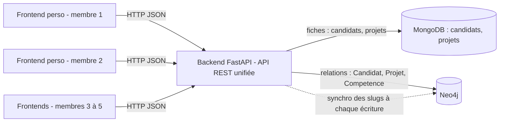
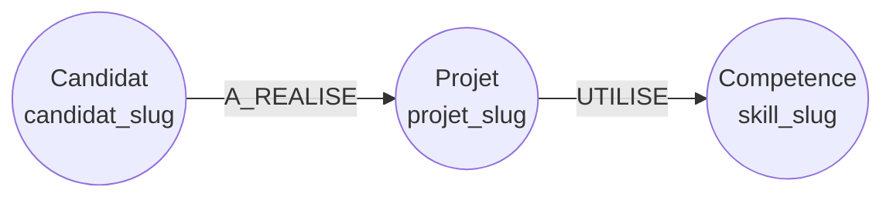

# 🧠 ARCHITECTURE - Équipe `Akatsuki`

> Document de spécification du Portfolio Polyglotte — Équipe Akatsuki.
> Il décrit l'architecture retenue, les modèles de données MongoDB et Neo4j, les requêtes servies, les règles de cohérence inter-bases et la répartition du travail d'équipe.

## 1. Schéma d'architecture

Montrez **qui stocke quoi** et **quels flux** : frontends → API → MongoDB / Neo4j.

**Recommandé : [Excalidraw](https://excalidraw.com)** (à plusieurs via *Live collaboration*). Exportez en PNG ou SVG avec **« Embed scene »** coché,
enregistrez dans `docs/architecture.excalidraw.png`, puis remplacez le schéma Mermaid ci-dessous par :

``

L'image reste modifiable : rouvrez-la dans Excalidraw (ou dans VS Code avec l'extension *Excalidraw*).



**Rôle de chaque base.** MongoDB est notre **source de vérité documentaire** : elle stocke les fiches complètes des candidats (profil, timeline, expériences, formations) et des projets (description, auteurs, compétences listées, liens). C'est la base interrogée pour tout affichage de contenu, et les agrégations y produisent les statistiques par compétence. Neo4j est notre **source de vérité relationnelle** : il ne stocke que les slugs (`candidat_slug`, `projet_slug`, `skill_slug`) et les relations `A_REALISE` / `UTILISE` pour répondre efficacement aux questions de graphe (projets similaires, compétences communes, graphe d'un candidat) sans avoir à calculer les traversées côté application. Les deux bases sont reliées par les **slugs pivots** : toute écriture passe par MongoDB d'abord, puis Neo4j est synchronisé par `MERGE` idempotent, ce qui le rend entièrement reconstructible depuis MongoDB.

## 2. Les requêtes à servir

| # | Besoin (vu par un recruteur) | Route API | Base(s) interrogée(s) |
|---|---|---|---|
| R1 | Profil + timeline (expériences, formations) d'un candidat | `GET /api/candidats/{slug}` | MongoDB (candidats, un seul document) |
| R2 | Projets d'un candidat, filtrables par compétence | `GET /api/candidats/{slug}/projets` | MongoDB (projets, filtre indexé) |
| R3 | Statistiques d'un candidat par compétence | `GET /api/candidats/{slug}/stats` | MongoDB (pipeline d’agrégation) |
| R4 | Projets similaires à un projet | `GET /api/graph/projets/{slug}/similaires` | Neo4j, puis MongoDB pour les fiches |
| R5 | Graphe de compétences d'un candidat | `GET /api/graph/competences/{slug}` | Neo4j |
| R6 | Compétences communes à plusieurs candidats (intersection pour mise en avant d'équipe) | `GET /api/graph/competences/communes` | Neo4j |
| R7 | Compétences transversales d’un candidat (utilisées dans plusieurs projets) | `GET /api/graph/candidats/{slug}/competences-transversales` | Neo4j |
| R8 | Derniers projets de l’équipe, triés par date | `GET /api/projets/recents` | MongoDB (index sur la date) |
| R9 | Preuves d’une compétence: projets et expériences qui la mobilisent | `GET /api/competences/{slug}/preuves` | Neo4j (slugs), puis MongoDB (contenu) |

## 3. Modèle MongoDB

### 3.1 Collection `candidats` - pattern *Embedding*

```json
{
  "_id": "alice-martin",
  "candidat_slug": "alice-martin",
  "nom": "Martin",
  "prenom": "Alice",
  "titre": "Étudiante ingénieure en data, recherche une alternance",
  "bio": "Passionnée par les données et les architectures backend.",
  "contacts": {
    "email": "alice.martin@example.com",
    "github": "https://github.com/alice-martin",
    "linkedin": "https://linkedin.com/in/alice-martin"
  },
  "langues": [
    { "langue": "Français", "niveau": "Natif" },
    { "langue": "Anglais", "niveau": "C1" }
  ],
  "experiences": [
    {
      "type": "stage",
      "entreprise": "Acme Data",
      "poste": "Stagiaire data engineer",
      "debut": "2025-06-01",
      "fin": "2025-08-31",
      "description": "Mise en place d'un pipeline d'ingestion de données."
    },
    {
      "type": "alternance",
      "entreprise": "Normandie Tech",
      "poste": "Développeuse backend",
      "debut": "2026-09-01",
      "fin": null,
      "description": "Développement d'API REST en Python."
    }
  ],
  "formations": [
    {
      "ecole": "ESIGELEC",
      "diplome": "Diplôme d'ingénieur, majeure data",
      "debut": "2024-09-01",
      "fin": null
    },
    {
      "ecole": "Lycée Corneille",
      "diplome": "Baccalauréat scientifique",
      "debut": "2021-09-01",
      "fin": "2024-06-30"
    }
  ]
}
```

**Justification** (cardinalité bornée ou non, lecture en une requête, fréquence de mise à jour) : Les expériences, formations, langues et contacts sont bornés. Un candidat en a quelques-unes, rarement plus de 10 ou 20, donc le document reste très loin de la limite de 16 Mo. Ils sont toujours lus avec leur parent: R1 affiche le profil et la timeline, et une seule lecture suffit, sans jointure. Ils changent rarement, donc la mise à jour du document entier n’est pas un coût. Enfin, ils n’ont pas d’identité propre et ne sont pas partagés entre candidats: une expérience appartient à une seule personne. L’embedding est donc le bon choix. Les projets, eux, ne sont pas imbriqués dans le candidat (voir 3.2).

### 3.2 Collection `projets` - pattern *Referencing*

```json
{
  "_id": "smartcity-explorer",
  "projet_slug": "smartcity-explorer",
  "titre": "SmartCity Explorer",
  "description": "Application de visualisation de données urbaines combinant MongoDB et Neo4j.",
  "type": "academique",
  "date_debut": "2026-01-15",
  "date_fin": "2026-03-30",
  "auteurs": ["alice-martin", "bob-durand"],
  "competences": [
    { "skill_slug": "python", "nom": "Python" },
    { "skill_slug": "mongodb", "nom": "MongoDB" },
    { "skill_slug": "fastapi", "nom": "FastAPI" }
  ],
  "liens": {
    "github": "https://github.com/nosql-esigelec/smartcity-explorer",
    "demo": null
  },
  "resultats": "Prototype fonctionnel présenté en soutenance."
}
```

**Justification** : Un projet est une entité autonome, et il peut avoir plusieurs auteurs (auteurs). L’imbriquer dans candidats forcerait à le dupliquer chez chaque auteur, avec le risque de versions qui divergent. Le nombre de projets peut aussi croître sans limite connue, et leur description est longue, ce qui fait grossir le document candidat. Une collection dédiée permet de filtrer par compétence (R2), de trier par date (R8) et d’agréger sur les compétences (R3). La liaison avec le candidat se fait par le slug: projets.auteurs contient des candidat_slug. On ne stocke donc pas de liste de projets dans candidats, ce qui évite d’avoir à maintenir les deux côtés cohérents.


### 3.3 Index

| Collection | Index | Requête servie (R#) |
|---|---|---|
| candidats | _id (= candidat_slug), créé automatiquement, unique | R1 |
| projets | _id (= projet_slug), créé automatiquement, unique |  R4 et R9 (récupérer les fiches à partir des slugs donnés par Neo4j) |
| projets | { auteurs: 1, date_debut: -1 } | R2 (projets d’un candidat, triés par date), R3 ($match sur l’auteur au début du pipeline) |
| projets | { "competences.skill_slug": 1 }| R2 (filtre par compétence), R9 |
| projets | { date_debut: -1 } | R8 (derniers projets de l’équipe) |


```javascript
db.projets.createIndex({ auteurs: 1, date_debut: -1 })
db.projets.createIndex({ "competences.skill_slug": 1 })
db.projets.createIndex({ date_debut: -1 })
```

### 3.4 Pipeline d'agrégation clé (R3)

```javascript
db.projets.aggregate([
  // 1. Ne garder que les projets du candidat (utilise l'index { auteurs: 1, date_debut: -1 })
  { $match: { auteurs: "alice-martin" } },

  // 2. Un document par couple (projet, compétence)
  { $unwind: "$competences" },

  // 3. Regrouper par compétence
  { $group: {
      _id: "$competences.skill_slug",
      nom: { $first: "$competences.nom" },
      nb_projets: { $sum: 1 },
      projets: { $push: "$projet_slug" },
      premiere_utilisation: { $min: "$date_debut" },
      derniere_utilisation: { $max: "$date_debut" }
  } },

  // 4. Les compétences les plus utilisées d'abord
  { $sort: { nb_projets: -1, _id: 1 } },

  // 5. Mise en forme de la sortie
  { $project: {
      _id: 0,
      skill_slug: "$_id",
      nom: 1,
      nb_projets: 1,
      projets: 1,
      premiere_utilisation: 1,
      derniere_utilisation: 1
  } }
])
```
Exemple de résultat (c’est ce que renverra GET /api/candidats/{slug}/stats):

```javascript
[
  {
    "skill_slug": "python",
    "nom": "Python",
    "nb_projets": 3,
    "projets": ["smartcity-explorer", "portfolio-nosql", "chatbot-rh"],
    "premiere_utilisation": "2025-09-10",
    "derniere_utilisation": "2026-01-15"
  },
  {
    "skill_slug": "mongodb",
    "nom": "MongoDB",
    "nb_projets": 2,
    "projets": ["smartcity-explorer", "portfolio-nosql"],
    "premiere_utilisation": "2026-01-15",
    "derniere_utilisation": "2026-01-15"
  }
]
```
## 4. Modèle Neo4j

### 4.1 Schéma du graphe



| Label | Propriétés | Clé unique |
|---|---|---|
| `Candidat` | `candidat_slug` (string), `nom` (string), `prenom` (string) | `candidat_slug` |
| `Projet` | `projet_slug` (string), `titre` (string), `date_debut` (date) | `projet_slug` |
| `Competence` | `skill_slug` (string), `nom` (string) | `skill_slug` |

| Relation | De → Vers | Propriétés | Pourquoi ce sens |
|---|---|---|---|
| `A_REALISE` | `(:Candidat) → (:Projet)` | aucune | Un candidat **réalise** un projet. Sens actif qui correspond à la question « quels projets a fait ce candidat ? » (R5, R7). Un projet peut avoir plusieurs candidats (relations multiples en entrée côté projet). |
| `UTILISE` | `(:Projet) → (:Competence)` | aucune | Un projet **utilise** une compétence. Sens qui correspond aux questions « quelles compétences ce projet mobilise ? » et « quels projets utilisent cette compétence ? » (R4, R9). La relation reste simple (pas de poids) : la fréquence d'utilisation s'obtient en comptant les projets côté MongoDB. |

### 4.2 Les 3 requêtes Cypher clés

```cypher
// R4 - projets similaires (nombre de compétences partagées)
MATCH (p:Projet {projet_slug: $projet_slug})-[:UTILISE]->(s:Competence)
      <-[:UTILISE]-(autre:Projet)
WHERE autre <> p
WITH autre, collect(DISTINCT s.skill_slug) AS competences_communes
RETURN autre.projet_slug AS projet_slug,
       autre.titre AS titre,
       competences_communes,
       size(competences_communes) AS score
ORDER BY score DESC, projet_slug
LIMIT $limit;

// R5 - graphe de compétences d'un candidat (paires projet-compétence)
MATCH (c:Candidat {candidat_slug: $candidat_slug})-[:A_REALISE]->(p:Projet)
      -[:UTILISE]->(s:Competence)
RETURN c.candidat_slug AS candidat,
       p.projet_slug AS projet_slug,
       p.titre AS projet_titre,
       s.skill_slug AS skill_slug,
       s.nom AS skill_nom;

// R6 - compétences communes à tous les candidats d'une liste
MATCH (c:Candidat)-[:A_REALISE]->(:Projet)-[:UTILISE]->(s:Competence)
WHERE c.candidat_slug IN $candidats
WITH s, collect(DISTINCT c.candidat_slug) AS membres
WHERE size(membres) = size($candidats)
RETURN s.skill_slug AS skill_slug, s.nom AS nom, membres
ORDER BY nom;
```

### 4.3 Contraintes

```cypher
CREATE CONSTRAINT candidat_slug_unique IF NOT EXISTS
FOR (c:Candidat) REQUIRE c.candidat_slug IS UNIQUE;

CREATE CONSTRAINT projet_slug_unique IF NOT EXISTS
FOR (p:Projet) REQUIRE p.projet_slug IS UNIQUE;

CREATE CONSTRAINT skill_slug_unique IF NOT EXISTS
FOR (s:Competence) REQUIRE s.skill_slug IS UNIQUE;
```

## 5. Cohérence entre les bases (slugs pivots)

| Entité | Slug | Dans MongoDB | Dans Neo4j |
|---|---|---|---|
| Candidat | `candidat_slug` (ex. `alice-martin`) | candidats._id et candidats.candidat_slug. Référencé dans projets.auteurs[]. | Propriété candidat_slug du nœud (:Candidat), unique. |
| Projet | `projet_slug` (ex. `smartcity-explorer`) | projets._id et projets.projet_slug. | Propriété projet_slug du nœud (:Projet), unique. |
| Compétence | `skill_slug` (ex. `mongodb`) | Pas de collection dédiée. Présent dans projets.competences[].skill_slug. | Propriété skill_slug du nœud (:Competence), unique. |


**Gouvernance**
- Source de vérité des entités : MongoDB (candidats, projets)
- Source de vérité du contenu : MongoDB (descriptions, dates, liens, expériences, formations)
- Source de vérité des relations : Neo4j pour la navigation (A_REALISE, UTILISE). Elles sont dérivées de
  projets.auteurs et projets.competences, écrits dans MongoDB, donc Neo4j est reconstructible.
- Identifiant commun : le slug (candidat_slug, projet_slug, skill_slug)
- 2 règles de cohérence :
  1. Tout slug présent dans Neo4j doit correspondre à une fiche MongoDB (candidat, projet) ou à une
     compétence listée dans au moins un projet MongoDB.
  2. Toute écriture suit le même ordre: MongoDB d'abord, puis Neo4j par MERGE idempotent. Le seed et la
     synchronisation sont relançables sans créer de doublons.

     
**Suppression d'un projet** : que faites-vous dans chaque base ? 
1- MongoDB: supprimer le document dans projets (par projet_slug). Il n’y a rien d’autre à nettoyer, puisque candidats ne stocke pas de liste de projets (voir 3.1).
2- Neo4j: MATCH (p:Projet {projet_slug: $slug}) DETACH DELETE p. Cela supprime le nœud et ses relations A_REALISE et UTILISE.
3- Compétences orphelines: les nœuds Competence restent par défaut, car d’autres projets peuvent les utiliser. Un nettoyage optionnel supprime ceux qui n’ont plus aucun projet: MATCH (s:Competence) WHERE NOT (s)<-[:UTILISE]-() DELETE s.
4- En cas d’échec à l’étape 2: le projet n’existe plus dans MongoDB mais reste dans Neo4j. Le service API ignore alors tout slug dont la fiche est introuvable lors de la récupération (R4, R9), et un script de resynchronisation idempotent reconstruit Neo4j depuis MongoDB.

## 6. Répartition du travail

### 6.1 Plan Jalon 2 Backend (5 phases)

Le backend est découpé en 5 phases. Les phases **A → B → C → D → E** s'enchaînent, mais les lots à l'intérieur d'une phase peuvent être traités en parallèle.

#### Phase A — Fondations (bloquantes, en série)

| Lot | Tâche | Dépendances |
|---|---|---|
| A1 | `db/neo4j.py` : singleton `AsyncDriver` + tests mockés | — |
| A2 | Chaque membre pousse ses vraies données `data/candidats/<pseudo>.json` + `data/projets/<pseudo>.json` | — |
| A3 | Modèles Pydantic complets dans `models/` (CandidatOut, ExperienceOut, FormationOut, ProjetOut, StatsOut, GraphOut, etc.) conformes à `API_ROUTES.md` | — |

#### Phase B — Accès données (parallélisable après A)

| Lot | Tâche | Dépendances |
|---|---|---|
| B1 | Repositories MongoDB : `mongo_candidats.py` (R1, R2, R3, R8) + `mongo_projets.py` (hydratation par slugs pour R4/R9) + création des index (§ 3.3) | A3 |
| B2 | Repository Neo4j : `neo4j_graph.py` avec les 5 Cypher paramétrées (R4, R5, R6, R7, R9) | A1, A3 |
| B3 | Script `seed.py` idempotent : vidage + insertion Mongo, puis `MERGE` Neo4j, création des contraintes (§ 4.3) | A1, A2, A3 |

#### Phase C — Orchestration (après B)

| Lot | Tâche | Dépendances |
|---|---|---|
| C1 | `services/candidats_service.py` : combine les repos Mongo pour profil / projets / stats | B1 |
| C2 | `services/graph_service.py` : orchestration Neo4j → Mongo (R4 et R9 renvoient des slugs depuis Neo4j, puis hydratent les fiches via Mongo) | B1, B2 |

#### Phase D — Exposition API (après C)

| Lot | Tâche | Dépendances |
|---|---|---|
| D1 | `api/routes_candidats.py` : R1, R2, R3, R8 + enregistrement dans `main.py` via `app.include_router` | C1 |
| D2 | `api/routes_graph.py` : R4, R5, R6, R7, R9 + enregistrement dans `main.py` | C2 |
| D3 | Vérifier que Swagger (`/docs`) liste toutes les routes et que CORS autorise les frontends | D1, D2 |

#### Phase E — Qualité + livrable

| Lot | Tâche | Dépendances |
|---|---|---|
| E1 | Tests unitaires par couche (repos avec mocks de drivers, services avec mocks de repos, routes avec `TestClient`) | B, C, D |
| E2 | Test de reproductibilité (critère B.1) : sur clone frais, `just up && just seed && just dev` → les 9 routes répondent | D3 |
| E3 | README backend : prérequis, commandes, exemples `curl` pour chaque route | D3 |

### 6.2 Répartition par membre

Chaque membre a un **lot backend** (contribution au critère équipe 40 %) et son **frontend personnel** (critère individuel 30 %). Les rôles backend sont alignés avec le domaine du frontend pour maximiser la connaissance de bout en bout.

| Membre (pseudo GitHub) | Backend (couches / routes) | Frontend |
|---|---|---|
| `ErwannNobime` — Lead infra & seed | A1 (driver Neo4j) + B3 (seed Mongo+Neo4j idempotent) + E2 (test machine neuve) | `frontends/frontend-ErwannNobime/` |
| `Donatienmhg` — Lead modèles + Candidats | A3 (modèles Pydantic) + B1 partie `mongo_candidats` + C1 (service candidats) + D1 (routes R1/R2/R3/R8) | `frontends/frontend-Donatienmhg/` |
| `andrea06-hub` — Lead Projets + hydratation | B1 partie `mongo_projets` (hydratation par slugs) + contribution à C1 | `frontends/frontend-andrea06-hub/` |
| `Rayan-esig` — Lead Graph Neo4j | B2 (repo Neo4j) + C2 (service graph) + D2 (routes R4/R5/R6/R7/R9) | `frontends/frontend-Rayan-esig/` |
| `Ayadjenou` — Qualité + démo + relecture | E1 (tests unitaires toutes couches) + E3 (README) + E2 en binôme + revue des PR | `frontends/frontend-Ayadjenou/` |

### 6.3 Jalons de synchronisation

Pour éviter que les frontends attendent la fin du backend, on fige les checkpoints suivants :

- **Checkpoint 1** : R1 répond → tout le monde peut commencer la vue *profil / timeline*.
- **Checkpoint 2** : R2 et R5 répondent → tout le monde peut avancer sur 2 vues sur 3.
- **Checkpoint 3** : toutes les routes d'`API_ROUTES.md` répondent → lock du contrat, plus de changement sans PR relue par toute l'équipe.
